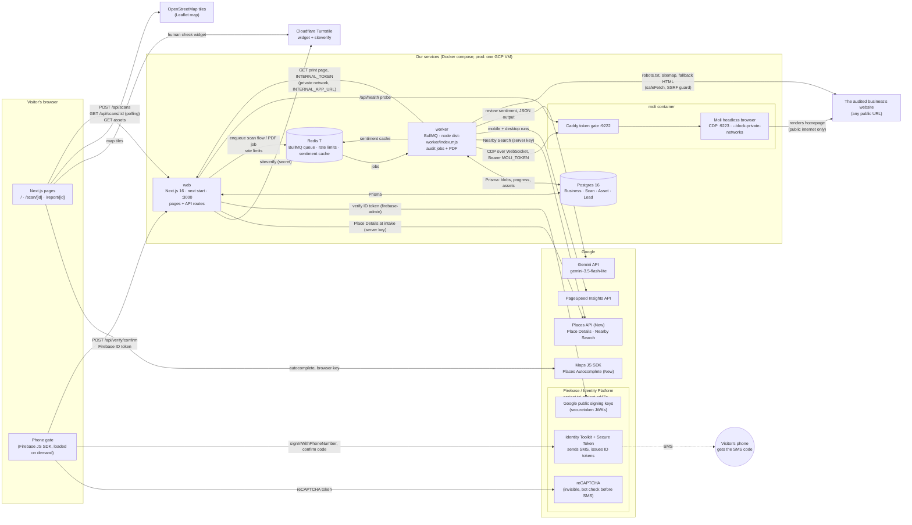
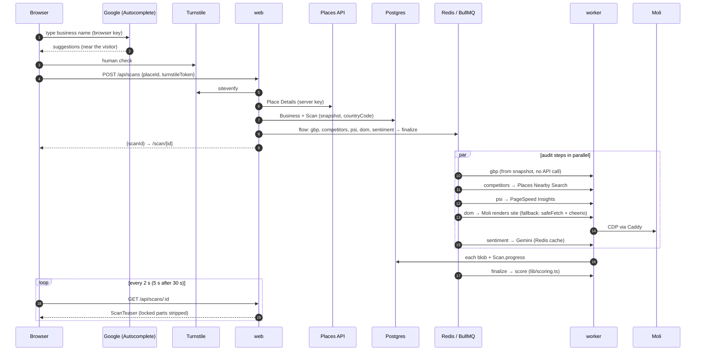
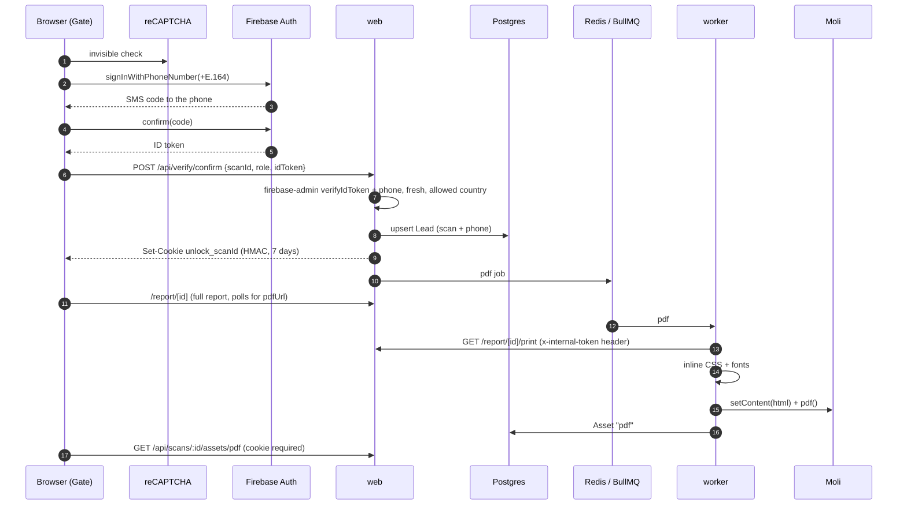

# Architecture

What runs where, what talks to what, and every outside service the code uses. Accurate as of Phase 5
(2026-10-23). SPEC.md is the source of truth for rules and contracts; this file is the map.

## 1. The whole system

Not connected yet: **CRM** (Zoho Bigin, deferred; leads wait in Postgres with `crmSyncedAt` null) and the **GCP VM**
(deploy target, Phase 6: Compute Engine in asia-south1, Caddy in front of web). **WhatsApp** was in the original plan and has been removed.

## 2. Our services

| Service | What it does | Runs as | Listens | Talks to |
|---|---|---|---|---|
| **web** | Pages (landing, live scan, report, print), API routes, Firebase token check | `next start` (Next.js 16, Cache Components) | `:3000` (the only public port) | Postgres, Redis, Moli health, Places, Turnstile, Google public keys |
| **worker** | Runs every BullMQ job: the 5 audit steps, `finalize`, `pdf` | `node dist-worker/index.mjs` (same image as web), concurrency 4 | nothing | Redis, Postgres, Moli, web (print page), Places, PSI, Gemini, audited websites |
| **moli** | Headless browser for the DOM audit and the PDF | Moli (Rust, CDP) behind Caddy (`docker/moli/`) | `:9222` private only | the public internet only (`--block-private-networks`) |
| **postgres** | All durable data, including screenshots and PDFs | `postgres:16-alpine` | `:5432` private | — |
| **redis** | Queue, rate limits, sentiment cache | `redis:7-alpine`, `noeviction`, 128 MB | `:6379` private | — |

Local dev: `docker-compose.dev.yml` publishes Postgres, Redis and Moli on `127.0.0.1` so `pnpm dev` and
`pnpm worker:dev` run on the host. Only `web` is published in the full compose stack.

## 3. Outside services (everything integrated)

| Service | Called from | Used for | Credential (env) | Notes |
|---|---|---|---|---|
| **Google Maps JS SDK – Places Autocomplete (New)** | Browser (`PlacesSearch.tsx`) | Business search box | `NEXT_PUBLIC_GOOGLE_BROWSER_KEY` | Worldwide, no region lock; Google ranks results by visitor IP. Key is referrer-restricted. |
| **Places API (New) – Place Details** | web (`POST /api/scans`, `lib/google/places.ts`) | Snapshot of the business: name, address, country, phones, rating, reviews, hours, photos | `GOOGLE_SERVER_KEY` | Enterprise + Atmosphere tier field mask. Snapshot purged after 30 days. |
| **Places API (New) – Nearby Search** | worker (`competitors` job) | Up to 10 same-type businesses within 3 km | `GOOGLE_SERVER_KEY` | Enterprise tier mask. Never scrape Google. |
| **PageSpeed Insights API** | worker (`psi` job) | Mobile + desktop Lighthouse scores, CWV, screenshots | `PSI_API_KEY` (else `GOOGLE_SERVER_KEY`) | ~40 s per strategy, run in parallel. |
| **Gemini API** | worker (`sentiment` job, `lib/gemini.ts`) | Loves / complaints / positive ratio from reviews | `GEMINI_API_KEY`, `GEMINI_MODEL` | `gemini-3.5-flash-lite`, structured JSON. Cached 30 days per place in Redis. |
| **Cloudflare Turnstile** | Browser widget + web (`lib/turnstile.ts`) | Human check before a scan starts | `NEXT_PUBLIC_TURNSTILE_SITE_KEY`, `TURNSTILE_SECRET` | Fails closed. |
| **Firebase Auth – Identity Toolkit, Secure Token, reCAPTCHA** | Browser (`Gate.tsx`, `lib/firebase-client.ts`) | Sends the SMS code, checks it, issues an ID token | `NEXT_PUBLIC_FIREBASE_API_KEY`, `_AUTH_DOMAIN`, `_PROJECT_ID` | Blaze plan, billed per SMS by country. SMS allow list = `NEXT_PUBLIC_PHONE_COUNTRIES`. Key restricted to our domains + auth APIs. |
| **Firebase Admin – token verification** | web (`lib/firebase-admin.ts`) | Verifies the ID token (signature, project, freshness, phone provider) | `FIREBASE_PROJECT_ID` | No service account; fetches Google's public keys. |
| **OpenStreetMap tiles** | Browser (`LeafletMap.tsx`) | Competitor map on the report | none | No Google Maps JS billing for the map. |
| **Audited websites** | Moli (render) and worker (`safeFetch`) | On-page SEO, robots.txt, sitemap, NAP match | none | SSRF guard: public IPs only, 5 redirects, 20 s, 5 MB; robots.txt respected. |
| **Zoho Bigin (CRM)** | — | Lead push | — | Deferred by the user. |

## 4. Flow: from search to score

## 5. Flow: unlock and PDF

## 6. Web routes

| Route | Kind | What it does | Guard |
|---|---|---|---|
| `/` | page (static) | Landing + business search / website input | — |
| `/scan/[id]` | page | Live stepper, teaser, locked sections, phone gate | unlock cookie shows the unlocked state |
| `/report/[id]` | page | Full report + "Download PDF" | unlock cookie, else redirect to `/scan/[id]` |
| `/report/[id]/print` | page | PDF source for the worker | `INTERNAL_TOKEN` |
| `POST /api/scans` | API | Create or reuse a scan | Turnstile; 5/min, 30/day per IP; 3/day per place |
| `GET /api/scans/:id` | API | Teaser or full report JSON | 60/min per IP; full report needs the cookie |
| `GET /api/scans/:id/assets/:kind` | API | Screenshot or PDF bytes | 120/min per IP; PDF needs the cookie |
| `POST /api/verify/confirm` | API | Firebase ID token → unlock cookie + Lead + PDF job | 20/10 min per IP, 10/hour per phone |
| `GET /api/health` | API | `{ db, redis, moli }` up/down | none (health checks) |

## 7. Worker jobs (one BullMQ queue: `scan`)

| Job | Does | Outside calls | Writes |
|---|---|---|---|
| `gbp` | Google profile checklist | none (uses the intake snapshot) | `Scan.gbp` |
| `competitors` | Nearby same-type businesses | Places Nearby Search | `Scan.competitors` |
| `psi` | Speed scores + screenshots | PageSpeed Insights | `Scan.psi`, `Asset` screenshots |
| `dom` | On-page SEO, robots, sitemap, NAP | Moli → website; fallback `safeFetch` | `Scan.domAudit` |
| `sentiment` | Review themes | Gemini (cached 30 days) | `Scan.sentiment` |
| `finalize` | Score, grade, rank, fixes (runs after the five, even if some fail) | none | `Scan.score`, `status = done` |
| `pdf` | Report PDF after a verified unlock | web print page → Moli | `Asset` pdf |
| `ping` | Queue smoke test (`pnpm queue:ping`) | none | — |
| `retention` | Nightly cleanup (stub, Phase 6) | none | — |

Defaults: 2 attempts, exponential backoff; a step that gives up is marked `failed` and the scan still finishes.

## 8. Where data lives

| Store | What | Retention |
|---|---|---|
| Postgres `Business` | One row per Google place or website | kept |
| Postgres `Scan` | Status, progress, snapshot, five audit blobs, score | snapshot purged after 30 days (Phase 6 job); rest kept |
| Postgres `Asset` | Screenshots (JPEG) and PDFs, as bytes | screenshots 90 days (Phase 6 job) |
| Postgres `Lead` | Phone (E.164), country, role, Firebase uid, `verifiedAt`, `crmSyncedAt` | kept |
| Redis `bull:scan:*` | Queue state | completed jobs trimmed at 500 |
| Redis `rl:<limit>:<hash>` | Sliding-window rate limits, keyed by HMAC of IP / phone / place | window length |
| Redis `sentiment:<placeId>` | Gemini result | 30 days |
| Browser cookie `unlock_<scanId>` | HMAC-signed `{scanId, leadId, exp}`, httpOnly, SameSite=Lax | 7 days |

## 9. Trust boundaries

- **Public:** only `web :3000`. Moli, Postgres and Redis are on the private network.
- **Browser-visible keys** (public by design, all restricted): Maps browser key, Turnstile site key, Firebase web config.
  Everything else is server-only and read through `env()` (`src/lib/env.ts`).
- **Moli** can't reach private networks, so it never sees our services. The PDF HTML is handed to it with `setContent()`.
- **Phone numbers** are trusted only from a verified Firebase ID token, stored as E.164, and never logged
  (pino redacts phone, code, token, idToken, cookie).
- **User-supplied URLs** go through the SSRF guard (`src/lib/ssrf.ts`) before any fetch or Moli navigation.

## 10. Configuration map

| Variable | Read by | Build arg? |
|---|---|---|
| `DATABASE_URL`, `REDIS_URL` | web, worker | no |
| `MOLI_URL`, `MOLI_TOKEN` | web (health), worker; `MOLI_TOKEN` also the Caddy gate | no |
| `GOOGLE_SERVER_KEY`, `PSI_API_KEY` | web (Details), worker (Nearby, PSI) | no |
| `GEMINI_API_KEY`, `GEMINI_MODEL` | worker | no |
| `TURNSTILE_SECRET` | web | no |
| `FIREBASE_PROJECT_ID` | web | no |
| `HASH_SALT`, `COOKIE_SECRET` | web, worker | no |
| `INTERNAL_TOKEN`, `INTERNAL_APP_URL` | web (print page), worker (PDF) | no |
| `SCAN_CACHE_DAYS`, `DEFAULT_COUNTRY`, `CRM_ENABLED` | web | no |
| `ONLINE_MODE` | web (API + landing page) | yes |
| `NEXT_PUBLIC_GOOGLE_BROWSER_KEY`, `NEXT_PUBLIC_TURNSTILE_SITE_KEY` | browser | yes |
| `NEXT_PUBLIC_FIREBASE_API_KEY`, `_AUTH_DOMAIN`, `_PROJECT_ID`, `NEXT_PUBLIC_PHONE_COUNTRIES` | browser (gate); phone countries also web | yes |

## 11. Still to come (Phase 6)

Google Cloud deploy (one Compute Engine VM in asia-south1 running the compose stack behind Caddy; Cloud Build, Artifact Registry,
Secret Manager, Cloud Logging, `pg_dump` backups to Cloud Storage) on `audit.thesalesinc.com`; CSP and security
headers and the `/privacy` page are done (2026-10-24); the nightly `retention` job; the lead webhook to Make.com; real 404 status codes
via `proxy.ts`; live SMS tests. CRM push later, when the user picks it up.
